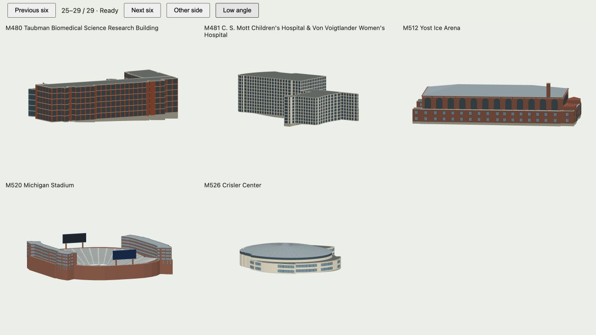

# Architectural Highlight form review

Reviewed 18 October 2026: all 29 building Highlights.

This audit records the individual massing, roof, entrance, facade and characteristic assemblies. A generic window-frame count is not evidence of architectural agreement. Official footprints and published heights remain distinct from photo-based estimates. Previously corrected presentation cameras and dedicated Alder/Suzzallo assemblies are preserved.

| Code | Highlight | Decision | Features reviewed | Reference |
|---|---|---|---|---|
| M003 | Detroit Observatory | reconstructed source-specific exterior | historic three-part observatory; 23-foot-diameter dome with observing slit; Doric porch facing Ann Street; meridian wing opening strip; separate low 2022 visitor addition and glazed connector | [Reference](https://detroitobservatory.umich.edu/history/) |
| M007 | Rackham Graduate School | reconstructed source-specific exterior | Indiana limestone high central hall and lower wings; copper gabled roof; three bronze-framed entrance portals; broad granite approach stairs; five shallow relief panels and long horizontal cornice | [Reference](https://rackham.umich.edu/about/rackham-building/history-of-the-rackham-building/) |
| M008 | North Quadrangle Residential & Academic Complex | reconstructed source-specific exterior | seven-storey L-shaped academic wing; ten-storey residence wing; two interlocking open courtyards; low cloister and tall dining lights; brick piers with limestone bands and entrance surrounds | [Reference](https://umaec.umich.edu/wp-content/uploads/2013/11/NQSustain.pdf) |
| M035 | Burton Memorial Tower | reconstructed source-specific exterior | limestone shaft with shallow vertical buttresses; five actual bell-chamber openings per face; three arched central slots and rectangular side slots; open metal clock rings, hands and hour marks; stepped upper chamber and copper crown; 53 suspended bronze bells | [Reference](https://tour.umich.edu/text-based/tours/diag/) |
| M038 | Michigan League | retained existing individual exterior after review | Brick academic and ballroom wings; Separate roof ranges and entrance enclosure; Stone string courses and Gothic facade trim | [Reference](https://tour.umich.edu/text-based/locations/michigan-league/) |
| M042 | Hill Auditorium | reconstructed source-specific exterior | four-storey brick auditorium; four Doric entrance columns and framed south portico; broad entrance steps; broken-slope raised hall roof; stone floor courses and brick attic frieze; separate low mapped ancillary footprint | [Reference](https://smtd.umich.edu/facilities/hill-auditorium/) |
| M080 | Angell Hall and Tisch Hall | retained existing individual exterior after review | Long Angell academic wing and lower Tisch companion; Eight-column classical west portico; Broad steps, limestone entablature and cornice; Confirmed small rooftop observatory | [Reference](https://bentley.umich.edu/discover/bentley-materials/campus-tour/building-index/angell-hall/) |
| M089 | Hatcher Graduate Library · North | retained existing individual exterior after review | Original north reading-hall volume; Lower and higher mapped library wings; Separate clay roof ranges; Diag-facing tall triplet masonry bays | [Reference](https://www.lib.umich.edu/visit-and-study/floor-plans/hatcher-library-north-floors/) |
| M098 | University of Michigan Museum of Art | retained existing individual exterior after review | Original neoclassical museum block; Four-column stone portico; Lower modern northern addition; Narrow glazed connecting wing and curved gallery edge | [Reference](https://tour.umich.edu/text-based/tours/diag/) |
| M101 | William L. Clements Library | retained existing individual exterior after review | Two-storey Italianate limestone library; Three tall northern arched loggia bays; Four framing stone piers; Broad low entrance stair and supported cornice | [Reference](https://clements.umich.edu/about/history/construction-of-the-library/) |
| M103 | Michigan Union | retained existing individual exterior after review | Original brick union ranges; Separate taller junction tower; Varied slate roof wings; Stone belts, framed entrance and mapped courtyards | [Reference](https://tour.umich.edu/text-based/locations/michigan-union/) |
| M112 | Lawyers Club and Charles T. Munger Residences | retained existing individual exterior after review | Low dining hall and residential wings; Actual open Law Quad courtyards; Individual steep slate roofs and dormers; Granite masonry, limestone trim and tall hall tracery | [Reference](https://michigan.law.umich.edu/about-michigan-law/michigan-law-architecture) |
| M126 | William W. Cook Legal Research Library | retained existing individual exterior after review | Tall stone tower and separate reading hall; Lower glazed library addition; Crenellated tower crown; Steep hall roof, tall Gothic lights and attached buttresses | [Reference](https://michigan.law.umich.edu/about-michigan-law/michigan-law-architecture) |
| M132 | Hutchins Hall | retained existing individual exterior after review | Separate Law Quad teaching ranges; Lower inner wing and preserved courtyard void; Steep slate roofs by wing; Stone belts, Gothic openings and dormers | [Reference](https://michigan.law.umich.edu/about-michigan-law/michigan-law-architecture) |
| M144 | Ross School of Business | retained existing individual exterior after review | Separate terracotta academic wings; Tall central glazed Winter Garden; Low pavilions with planted terraces; Window-zone terracotta shades and grounded Tappan canopy | [Reference](https://www.kpf.com/story/the-making-of-university-of-michigan-stephen-m-ross-school-of-business) |
| M342 | Ford Robotics Building | retained existing individual exterior after review | Four-storey metal/glass robotics laboratory; Lower high-bay research wing; Curved mapped glazed frontage; Attached facade members bounded to their own wings | [Reference](https://tour.umich.edu/text-based/tours/engineering/) |
| M377 | Bob & Betty Beyster Building | retained existing individual exterior after review | Brick teaching wings at different heights; Central glazed atrium and roof grid; Separate entrance volume; Roof edges and restrained wall-attached shades | [Reference](https://tour.umich.edu/text-based/tours/engineering/) |
| M379 | Leinweber Computer Science & Information Building | retained existing individual exterior after review | Buff masonry high and low research wings; Framed projecting window groups; All facade members stop at their own wing eaves; One documented set-back mechanical enclosure | [Reference](https://leinweber.bldg.umich.edu/about/) |
| M401 | Ann & Robert H. Lurie Tower | retained existing individual exterior after review | Brick shaft with stepped corner piers; Open bell cage and 60 bronze bells; Suspended acoustic blades; Flared playing cabin and copper hip cap | [Reference](https://smtd.umich.edu/facilities/ann-and-robert-h-lurie-carillon/) |
| M410 | Duderstadt Center | retained existing individual exterior after review | High library block and lower service wings; North glazed frontage and columned entry edge; Individual roof levels; Pyramidal glazed roof lights | [Reference](https://www.dc.umich.edu/about-the-dc/history/) |
| M420 | Art & Architecture Building | retained existing individual exterior after review | Older brick studio/classroom ranges; Separate white Taubman addition; Open courts and lower connection; Sloping addition roof and wall-attached glazing members | [Reference](https://taubmancollege.umich.edu/about/facilities/art-architecture-building/) |
| M428 | Gerald R. Ford Presidential Library | retained existing individual exterior after review | Low brick library/archives wing; Taller reading/research block; Separate zinc roof levels; Glazed entry and restrained masonry bays | [Reference](https://www.fordlibrarymuseum.gov/visit/library) |
| M464 | Frankel Cardiovascular Center | reconstructed source-specific exterior | separate clinical wings and low garden arrival; rounded winter-garden atrium; curved glazing and stone floor bands; courtyard-facing recesses; narrow mapped bridge wings kept low | [Reference](https://www.uofmhealth.org/locations-parking/floor-maps-ann-arbor-medical-campus-buildings/frankel-cardiovascular-center-floor-maps/floor-1-frankel-cardiovascular-center) |
| M472 | D. Dan & Betty Kahn Health Care Pavilion | reconstructed source-specific exterior | set-back patient tower and lower clinical podium; pale three-dimensional precast window bays; recessed glazed ground arrival; supported patient-dropoff canopy; separate narrow connection to Frankel | [Reference](https://www.hok.com/projects/view/michigan-medicine-kahn-health-care-pavilion/) |
| M480 | Taubman Biomedical Science Research Building | reconstructed source-specific exterior | terracotta laboratory bar; curved glazed office ribbon; sky-lit atrium between laboratory and office wings; independent round auditorium with tilted metal cap; continuous glass mullion and floor structure | [Reference](https://medschool.umich.edu/facility/alfred-taubman-biomedical-science-research-building-bsrb) |
| M481 | C. S. Mott Children's Hospital & Von Voigtlander Women's Hospital | reconstructed source-specific exterior | nine-storey outpatient wing; twelve-storey inpatient wing; lower clinical podium; curved patient facades with pale precast and dark glass bands; double-height glazed arrival and supported canopy | [Reference](https://umaec.umich.edu/projects/completed-projects/c-s-mott-childrens-womens-hospitals-replacement-project/) |
| M512 | Yost Ice Arena | reconstructed source-specific exterior | single tall Romanesque brick hall; tall round-headed side lights; ascending arched end windows; lower entrance blocks with arched doors; pitched roof with clay eaves and brick corbel course; masonry chimney | [Reference](https://tour.umich.edu/text-based/locations/yost-ice-arena/) |
| M520 | Michigan Stadium | retained existing individual exterior after review | Sunken bowl with ninety seat bands; 44 aisle divisions; Separate mapped east and west premium towers; North and south screens, correct playing-field axis and ground closure | [Reference](https://mgoblue.com/sports/2017/6/16/facilities-michigan-stadium-html) |
| M526 | Crisler Center | reconstructed source-specific exterior | near-circular arena and lower annex; continuous curved closed roof; clerestory band below roof rim; radial structural roof seams; glazed entrance with supported canopy | [Reference](https://umaec.umich.edu/projects/completed-projects/crisler-center-renovation-and-addition/) |

Browser review uses the actual exported 3DS building layers at the presentation view and the opposite side; focused low-angle views check open structures. Geometry, terrain contact, lossless compression, offline bytes and presentation framing are separately checked. This is a public-source exterior study, not surveyed BIM.

## Local browser review

Run `npm run build:highlight-review`, serve the repository locally and open `tmp/highlight-review.html` for the six-building review grid. Add `?code=` followed by a code from the table for a focused full-source view. This development gallery does not apply runtime LOD or ship as part of the public map.
